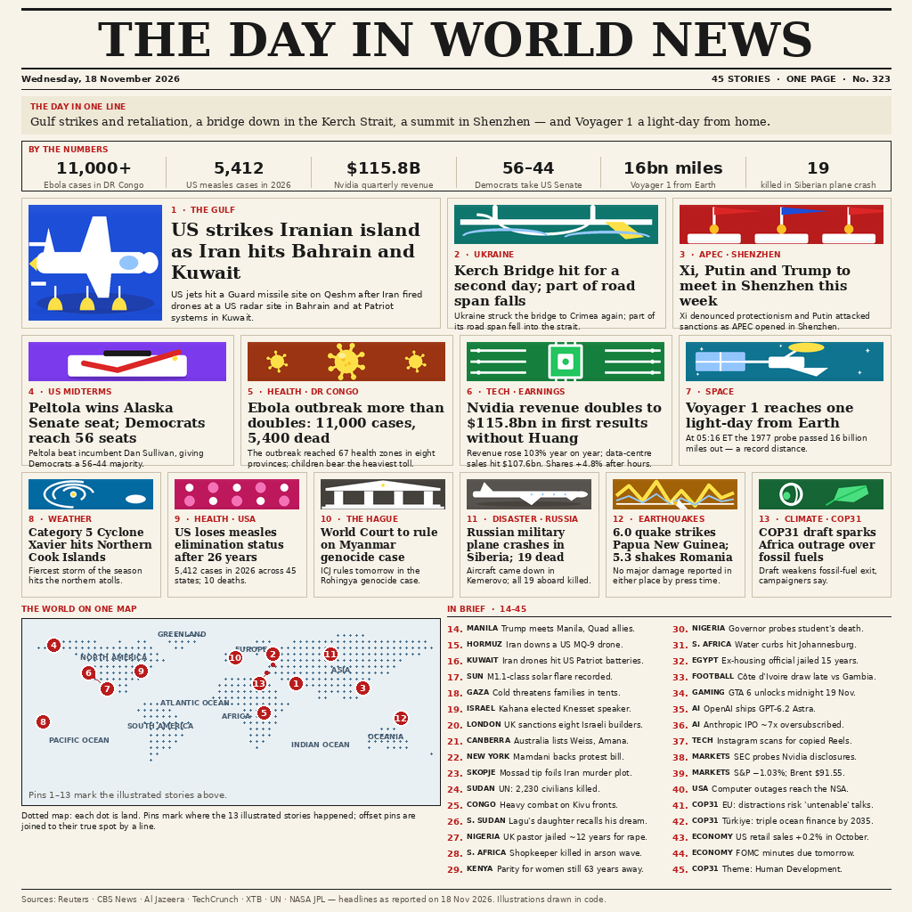

# THE DAY IN WORLD NEWS

[](https://make.fun/bounty/news-image-20261118)
[](https://make.fun/bounty/news-image-20261118)
[](https://make.fun/bounty/news-image-20261118)

**Wednesday, 18 November 2026 — 45 stories on one page.**

v3c: refined illustrations — each of the 13 motifs is drawn at 3–4x
into its own tile and LANCZOS-downscaled before pasting, so edges are
smooth, and motifs fill their panels. All texts, colours and layout
are unchanged from v3b.

A 1024×1024 newspaper front page summing up the world news of Wednesday
18 November 2026: 13 flat-illustrated feature stories, a one-line summary
of the day, a BY THE NUMBERS strip, a dotted world map with numbered pins
and labels, and briefs 14–45.



## Run it

```bash
python3 main.py            # renders output.png (1024x1024)
python3 main.py --check    # validate data + renderability, no file
python3 -m unittest discover -s tests -v
```

Stdlib only. Pillow is used **only** if it is importable **and** every DejaVu
face the script needs exists on the system. On a machine with no Pillow (or
missing fonts) `main.py` copies the bundled `entry.png` byte-for-byte to the
output path instead, so the page is pixel-identical either way. `entry.png`
is exactly what `main.py` renders here — the tests verify the hash matches a
fresh render.

## Layout

| Zone | Contents |
| --- | --- |
| Masthead | Title, date, "45 STORIES · ONE PAGE" |
| The day in one line | One-sentence summary of 18 November 2026 |
| By the numbers | Ebola 11,000+ · measles 5,412 · Nvidia $115.8B · Senate 56–44 · Voyager 16bn miles · 19 killed in Siberia |
| Stories 1–13 | Flat-illustrated features: Gulf strikes, Kerch Bridge, Shenzhen summit, Alaska Senate, Ebola, Nvidia, Voyager 1, Cyclone Xavier, measles, World Court, Siberian crash, quakes, COP31 |
| The world on one map | Dotted world map, continents and oceans labelled, pins 1–13 |
| In brief 14–45 | One line each, from Manila to COP31 |

## Files

- `main.py` — the whole page: data, flat illustrations, map, renderer, fallback
- `entry.png` — the bundled 1024×1024 front page
- `tests/test_main.py` — stdlib unittest: counts, fit checks, render, fallback
- `STRATEGY.md` — why the page is built this way
- `NOTES.md` — sources and build notes
- `LICENSE` — MIT

Competition: [news-image-20261118](https://make.fun/bounty/news-image-20261118) ($250, 50 paid places, entries close 20 Nov 2026 07:00 WIB).
